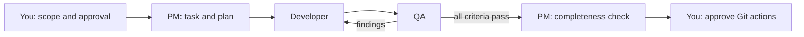

# Project OS for Claude Code and Codex

**Turn your AI coding assistant into a small software team with approval gates and a memory that lives in files.**

You talk to one session, the PM. It writes each piece of work down as a task with checkable acceptance criteria, asks for your approval, hands the task to a Developer, then to an independent QA that runs the tests itself, and reports back. Everything is saved in plain Markdown files, so when you close the session and open a new one, it picks up exactly where it stopped.

It solves three everyday problems:

| Problem | What Project OS does |
|---|---|
| The assistant forgets everything when the session ends | Board, tasks, decisions and a Hand-off note per task live in `planning/`; a new session reads them and continues |
| It changes code you never approved | No code before you approve the task's scope; commits, pushes and deployments each need their own approval |
| It marks its own work as done | QA is a separate role that runs the tests and checks every criterion; the Reviewer can only read |

Claude Code and Codex use the same files, so you can switch clients between steps.

## Quick start with Claude Code

You need [Node.js 22+](https://nodejs.org) and [Claude Code](https://code.claude.com/docs/en/quickstart). Nothing else is installed.

```sh
git clone https://github.com/ferhatcore/claude-codex-project-os.git
cd claude-codex-project-os
node scripts/init.mjs --target ../my-project --name "My Project"
cd ../my-project
claude
```

Then type `/project-os-start` and describe what you want to build. A typical first session:

```text
You:  /project-os-start
PM:   New project, no repositories or tasks yet. What should we build first?
You:  A small notes CLI in Node: add, list and delete notes, with tests.
PM:   Drafted T-001 with four acceptance criteria (AC-1 … AC-4). Approve scope and code?
You:  Approved. Code and tests only, no Git actions.
PM:   Recorded. project-os-developer is implementing T-001 …
      Developer handed over: 9 tests pass. project-os-qa is verifying …
      QA: AC-1 to AC-4 pass with evidence. T-001 is done (not committed).
```

Close the session whenever you like. Next time run `claude` and type `/project-os-resume`: the PM reads the board and Hand-off notes and tells you what is done and what comes next.

Want to look around first? Add `--example` to the install command to get Trailboard, a small reading-list project with one proposed task.

## What gets installed

A new folder (the installer never touches existing ones) containing:

```text
CLAUDE.md                 rules for the PM session
START.md                  first-session procedure
.project-os.json          project settings: repositories, worker cap, model preferences
.claude/agents/           project-os-developer, project-os-qa, project-os-reviewer (read-only)
.claude/skills/           /project-os-start, /project-os-task, /project-os-qa, /project-os-resume
planning/board.md         what is in progress
planning/tasks/           one file per task: criteria, approvals, QA report, Hand-off
planning/decisions.md     every approval, with date and wording
```

Nothing is written to your global Claude or Codex settings, and permissions stay as you have them. Subagents are limited by their tool lists, but your normal permission prompts still apply.

## Codex and both clients

```sh
node scripts/init.mjs --target ../my-project --runtime codex
node scripts/init.mjs --target ../my-project --runtime both
```

Codex gets `AGENTS.md`, four role definitions in `.codex/agents` and the same four skills (`$project-os-start` and others). With `both`, the two clients share one planning folder. Only one writer works in a repository at a time, whichever client it uses. See the [Codex guide](docs/codex.md).

## How a task moves



QA can send work back to the Developer twice. A third attempt needs a new plan and your approval. Risky changes also get a security review and the read-only Reviewer. "Done" means verified, not committed or deployed.

## Use it with existing code

Install a new workspace, then tell the PM where your repositories are during `/project-os-start`. It adds them to `.project-os.json` and proposes repository rules for your review. Your repositories keep their current files. See the [quickstart](QUICKSTART.md) and the [customization guide](docs/customization.md).

## More

1. [Quickstart](QUICKSTART.md): first session step by step, and connecting existing repositories.
2. [Claude Code notes](docs/claude-code.md) and [Codex setup](docs/codex.md).
3. [Workflows](docs/workflows.md), [customization](docs/customization.md) and [troubleshooting](docs/troubleshooting.md).
4. [Workspace templates](templates/workspace/README.md) and [repository rules](templates/repository/README.md).
5. [Test report](TEST-REPORT.md): what was tried with the real clients and what still fails.
6. [Contributing](CONTRIBUTING.md), [security](SECURITY.md) and [release records](release/READINESS.md).

## Run the checks

```sh
node scripts/check.mjs
node --test scripts/system.test.mjs scripts/smoke.test.mjs scripts/runtimes.test.mjs
node --test examples/trailboard/repos/catalog/catalog.test.mjs
```

They cover all runtime and profile choices, the installed agents and skills, shared task state, installation refusals and the example. GitHub Actions runs them on Windows and Linux with Node.js 22. They do not start a model.

## License

[MIT](LICENSE). Copyright (c) 2026 Ferhat Kosger. An independent project; not affiliated with Anthropic or OpenAI.
