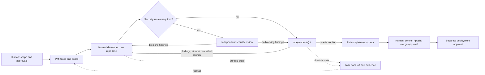

# Claude Code Project OS

**A file-based project management workflow for Claude Code.**

Keep an AI-assisted project moving from a clear task to an independently checked result. A central PM coordinates named developer, QA and specialist sessions through small briefs, explicit approvals and durable hand-offs. Use it for a single repository or several related repositories.

**Release status:** MIT-licensed v1.0.0 candidate. Copyright (c) 2026 Ferhat Kosger. Local checks pass; a real authenticated Claude Code smoke test and final publication approval remain pending. See [remaining gates](release/BLOCKERS.md) and the [readiness report](release/READINESS.md).

## What you get

- A PM operating manual, development and QA pipelines, and a compact task schema.
- Named roles, repository lanes and shared-resource locks.
- Human gates for code scope, Git operations, deployment, spending and contracts.
- Restartable context through task hand-offs, decisions and a board.
- Configurable model tiers, effort preferences and usage policies.
- A local installer, offline validation and a complete fictional two-repository example.
- A reproducible authenticated-session test guide and an offline smoke-test helper.

This is a workflow kit. It does not run a daemon, enforce a spending ceiling, create cloud resources or automatically control every Claude Code session. Files guide an assistant; tool permissions and human review remain necessary.

## Start in two minutes

You need an installed, authenticated Claude Code client. Node.js 22+ is used only for the installer, checks and example; Git is optional for setup and required for publication. No npm dependencies are installed. Claude usage is billed under your own account.

Download or clone this repository once it has been approved for distribution. From its root:

```sh
node scripts/init.mjs --target ../trailboard-demo --example --profile lean
cd ../trailboard-demo
node repos/catalog/catalog.mjs
node --test repos/catalog/catalog.test.mjs
claude
```

In Claude Code, paste:

```text
Read START.md and follow its bootstrap procedure. Act as the PM.
Inspect the example manifests and planning files. Report capabilities,
the next proposed task, and approval gaps. Do not change product code yet.
```

The installer refuses any existing destination. For your own project, omit `--example` and set `--name "My Project"`; connect existing repositories during onboarding. Follow the [quickstart](QUICKSTART.md) for both PowerShell and POSIX terminals.

## How work moves



For example, `TB-001` proposes an optional status filter for a local reading-list CLI. The developer receives one task and branch, implements it and records evidence. QA checks every acceptance criterion against the files and test output. The PM reports gaps before requesting a concrete Git operation. A changed criterion is dated in the task before anyone continues. The example task starts as `todo`; it contains no fabricated execution history.

Security and QA share the two-failed-cycle retry budget; a third cycle requires a revised plan and human authority.

## Repository map

| Path | Purpose |
|---|---|
| [QUICKSTART.md](QUICKSTART.md) | First PM session and first developer hand-off |
| [docs/architecture.md](docs/architecture.md) | Roles, state, trust and multi-repository boundaries |
| [docs/workflows.md](docs/workflows.md) | Code, design, documents, QA and advanced review |
| [docs/customization.md](docs/customization.md) | Profiles, model tiers, technologies and departments |
| [docs/troubleshooting.md](docs/troubleshooting.md) | Recovery and common failures |
| [docs/authenticated-smoke.md](docs/authenticated-smoke.md) | Real PM → Developer → QA → Review → Completion test procedure |
| [templates/workspace/](templates/workspace/README.md) | Files installed into a new PM workspace |
| [templates/repository/](templates/repository/README.md) | Evidence-based repository rule starter |
| [examples/trailboard/](examples/trailboard/README.md) | Fictional project, fixtures and proposed task |
| [scripts/](scripts/README.md) | Dependency-free setup and validation |
| [release/](release/CHECKLIST.md) | Publication instructions and launch materials |

## Configuration

The generated `.project-os.json` is this kit's configuration, not a native Claude Code settings file. The PM reads it explicitly. Choose `lean`, `standard` or `heavy`; map `economy`, `standard`, `deep` and `review` tiers to models available in your account. All selectors initially inherit the active model. Configure concrete repository paths, owners and test commands before authorising code. No model prices or account limits are assumed.

The baseline works with manually opened named sessions and file hand-offs. Native subagents or other integrations are optional; availability must be checked in your installed client. See [capabilities and official references](docs/claude-code.md).

## Limits and safety

Prompt gates express policy; they are not a sandbox or an access-control system. Keep normal Claude Code permissions enabled, use local fixture data, and inspect repository scripts before running them. A passing QA report does not mean a change has shipped. Usage thresholds are project policy, measured manually unless a verified tool supplies them. No schedules, hooks, external messages, provider accounts or production commands are installed.

## Contributing and licensing

Licensed under the [MIT License](LICENSE), selected by copyright holder Ferhat Kosger on 2026-11-11. Read [CONTRIBUTING.md](CONTRIBUTING.md), [SECURITY.md](SECURITY.md) and [PROVENANCE.md](PROVENANCE.md). Original private examples are excluded. This project is independent and is not endorsed by Anthropic. Claude Code is an Anthropic product.
