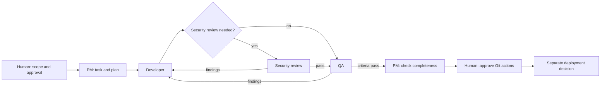

# Claude Code Project OS

A project structure for Claude Code, with task files, clear responsibilities and a separate QA step.

Start with a project manager session. It keeps track of decisions, writes tasks and assigns work. A developer session makes the change. A QA session checks the result against the task before it comes back for approval.

The useful part is that progress lives in files. You can close a session, open another one and continue from the task instead of explaining the project again. The same structure works for one repository or several related repositories.

## Try it

You need Claude Code and Node.js 22 or newer. There are no npm packages to install.

```sh
git clone https://github.com/ferhatcore/claude-code-project-os.git
cd claude-code-project-os
node scripts/init.mjs --target ../trailboard-demo --example --profile lean
cd ../trailboard-demo
node repos/catalog/catalog.mjs
node --test repos/catalog/catalog.test.mjs
claude
```

Then give the PM this message:

```text
Read START.md and follow its bootstrap procedure. Act as the PM.
Read the project configuration and planning files, then show me the
first proposed task and the decisions you need before starting it.
Do not change product code yet.
```

The example is a local reading list called Trailboard. It has a small CLI, a handbook and a proposed task for adding a status filter. It uses fictional data and needs no account or external service.

For your own project, run the installer without `--example`:

```sh
node scripts/init.mjs --target ../my-project-pm --name "My Project" --profile lean
```

The destination must be new. The installer creates the planning files there and leaves existing repositories alone. [Quickstart](QUICKSTART.md) covers the first session and connecting your own repositories.

## How a task moves



A task names its repository, scope, branch, acceptance criteria and permissions. After each step, the working session records what changed, what it checked and where to resume. QA checks each criterion independently. If scope changes, the task changes first.

Security and QA share a limit of two failed review cycles. A third cycle needs a new plan and human approval. Approval to write code does not also approve a commit, push or deployment.

## Sessions and configuration

The basic setup uses terminals you open yourself, with names such as `My Project : PM`, `My Project : Developer` and `My Project : QA`. The PM coordinates through files. Native subagents or other integrations can be added when the installed client supports them.

The generated `.project-os.json` holds the project name, language, repository list, budget profile and model preferences. It is read by the PM and checked by this project's validator; it is not a Claude Code settings file.

Choose `lean`, `standard` or `heavy` to set the worker cap. Map the model tiers to models available in your account. They inherit the current model until you choose otherwise. Usage observations and decisions stay in the planning log.

## What is in the repository

1. [Workspace templates](templates/workspace/README.md) for the PM, tasks, decisions, QA and reviews.
2. [Repository rules](templates/repository/README.md) for architecture, conventions, testing and delivery.
3. [Trailboard](examples/trailboard/README.md), a complete local example with two repository folders.
4. [Workflows](docs/workflows.md) for code, design, documents and review.
5. [Customization](docs/customization.md) for existing projects, different stacks and optional roles.
6. [Helper scripts](scripts/README.md) for setup and checks.
7. [Contribution guide](CONTRIBUTING.md) and [security policy](SECURITY.md).

## Run the checks

```sh
node scripts/check.mjs
node --test scripts/system.test.mjs scripts/smoke.test.mjs
node --test examples/trailboard/repos/catalog/catalog.test.mjs
```

The local suites contain 29 system and helper tests, plus 3 example tests. They cover setup, file and configuration checks, refusal paths, task state, CLI behavior and fixture integrity. GitHub Actions runs the system and helper suites on Windows and Linux with Node.js 22.

## License

[MIT](LICENSE). Copyright (c) 2026 Ferhat Kosger.

This is an independent project for Claude Code. It is not affiliated with Anthropic.
